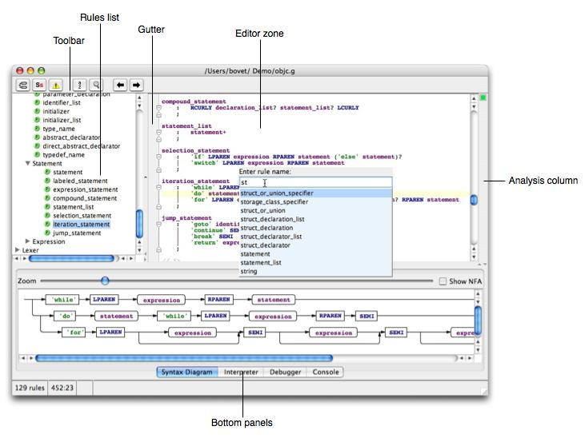
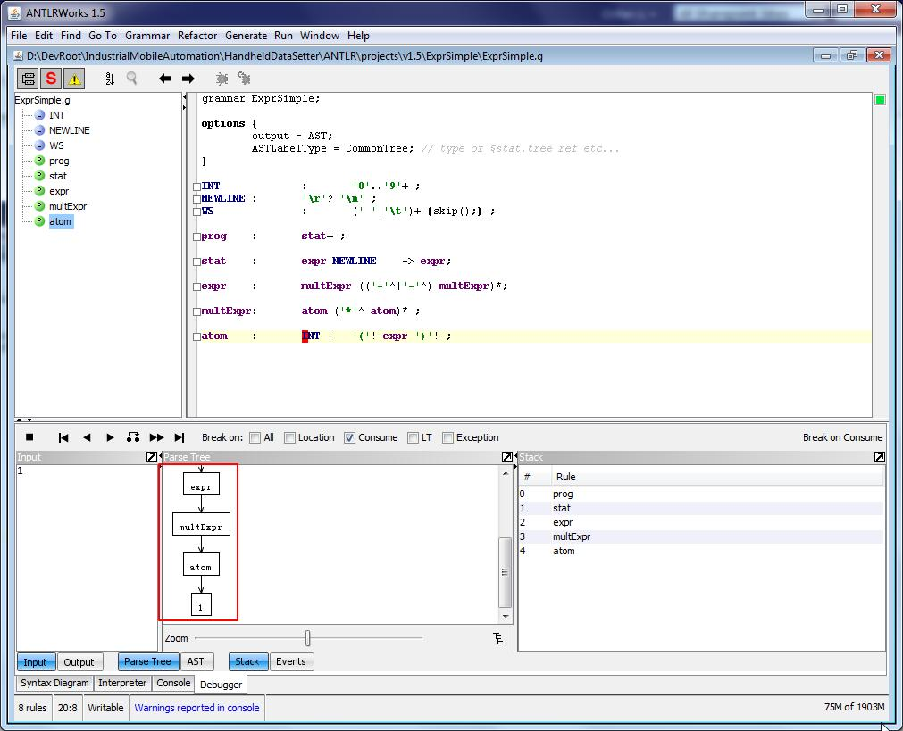

# ANTLR

## 1. Required files
- ANTLRWorks 1.5.2
- Java JDK 8
- Java.g - Java language grammar

## 2. Create the folders
```
C:\ANTLRWorks\
│
├── antlrworks-1.5.2-complete.jar
│
├── grammars\
│   └── Java.g
│
├── sources\
│   └── Example.java
│
└── results\
```
## 3. Install Java JDK
Install Java JDK and run `java-version` in `cmd`. 
You should see output similar to `openjdk version "1.8.0_xxx"`.
Next, run `javac -version`. Expected output is `javac 1.8.0_xxx`.

If either command is not recognized, configure the JDK installation's `bin` directory in your Windows `Path` environment variable.

## 4. Start ANTLRWorks 1.5.2
ANTLRWorks does not need a separate installation wizard.
Open Command Prompt and run:
```
cd /d C:\ANTLRWorks
java -jar antlrworks-1.5.2-complete.jar
```


The ANTLRWorks GUI should apprear.

You can also create a launcher for easier access.

Open Notepad, paste:
```
@echo off
cd /d C:\ANTLRWorks
java -Xmx1024m -jar antlrworks-1.5.2-complete.jar
pause
```
Save it as:
`C:\ANTLRWorks\Start-ANTLRWorks.bat`

Double-click this file whenever you want to start ANTLRWorks.

## 5. Configure ANTLRWorks

In ANTLRWorks:
1. Open File → Preferences (or the equivalent Preferences menu).
2. Open the **Compiler** settings.
3. Select `javac` as the compiler.
4. Confirm the JDK path if required.
5. Open the **General** settings.
6. Set an output folder, such as `C:\ANTLRWorks\results`.
7. Disable automatic update checks in the **Update** settings, if available.

These settings are documented in the ANTLRWorks preferences guide.

### 6. Open the Java grammar

Now load the grammar.
1. Select **File** → **Open**.
2. Navigate to `C:\ANTLRWorks\grammars`.
3. Select Java.g.
4. Click **Open**.

ANTLRWorks should display the grammar rules in its editor.

Look for rules such as:
- `compilationUnit`
- `classDeclaration`
- `fieldDeclaration`
- `methodDeclaration`

The linked grammar includes the `compilationUnit` entry rule and other Java language rules. 

If the grammar shows errors, inspect them before proceeding. This older grammar targets Java 1.5 syntax, so it is not suitable for all modern Java constructs.

## 7. Create a Java source file for testing

Open Notepad and paste:
```
public class Example {
    private int age;
    private String name;

    public void start() {
        calculate();
        System.out.println("Started");
    }

    private void calculate() {
        age++;
    }
}
```
Save as:
`C:\ANTLRWorks\sources\Example.java`

## 8. Parse the Java source code in ANTLRWorks



1. With `Java.g` open, switch to the **Interpreter** panel.
2. Select `compilationUnit` as the starting rule.
3. Open `Example.java` in Notepad.
4. Copy its entire contents.
5. Paste the code into the Interpreter's input area.
6. Click the Interpreter's **Run** control.
7. Examine the generated parse tree.

ANTLRWorks can display the parse tree as a list or graph.

For more detailed debugging, select **Debugger** → **Debug**, provide the same source code, and run the debugger. It can show the Parse Tree, Stack, and other execution details.

## 9. Inspect the Java declarations

For the example above, the expected analysis is:
```
Metric	                Count
Classes	                1
Member variables	      2
Member methods	        2
Internal method calls	  1
External method calls	  1
Total method calls	    2
```
These are the expected counts from reading the example, not a report ANTLRWorks automatically generates.

In the parse tree, inspect the relevant declaration and expression rules. You should be able to locate `Example`, `age`, `name`, `start`, `calculate`, and the method invocation expressions.

## 10. Understand what still requires development

At this point, you will have a working offline GUI environment for parsing and inspecting Java syntax.
```
Class	          Variables	        Methods	          External calls
Example	                2	              2	                       1
```

you must add custom analysis logic. ANTLRWorks alone does not perform project-wide symbol resolution or automatically classify calls as internal or external.

For example, it can recognize `System.out.println(...)` syntactically, but identifying its declaring type requires semantic information.
